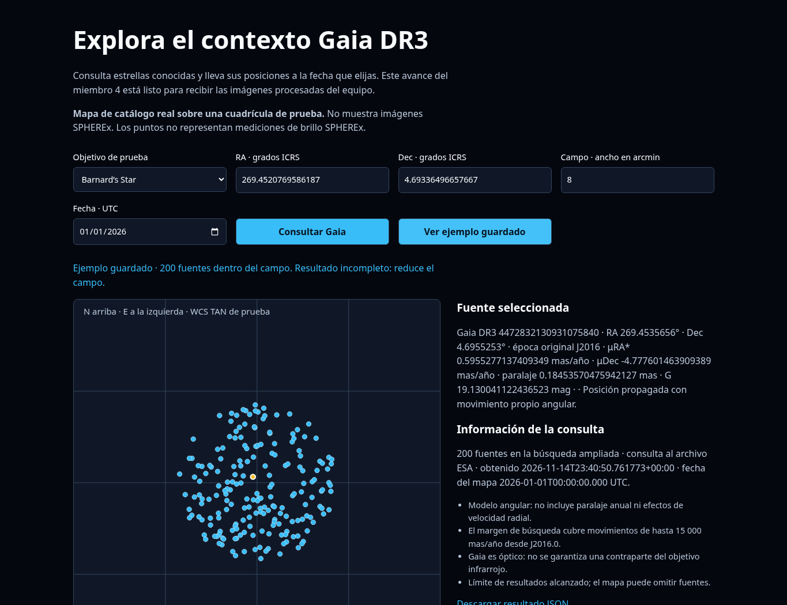

# Gaia DR3: módulo del miembro 4

Implementación independiente de los subsistemas de descarga y procesamiento SPHEREx. Contrato implementado en este fork; pendiente de acuerdo e integración con el equipo.

El [contrato SPHEREx propuesto](SPHEREX_API.md) define la entrega de observaciones, FITS, frames y WCS entre miembros.

## Ver el avance

Desde la raíz del repositorio:

```bash
python -m venv .venv
source .venv/bin/activate
pip install -r astro_engine/requirements.txt
python -m uvicorn main:app --app-dir astro_engine --host 127.0.0.1 --port 8000
```

Abre http://localhost:8000/catalogues/demo y pulsa **Ver ejemplo guardado** para ver fuentes Gaia reales sin consultar la red. **Consultar Gaia** consulta el archivo ESA con tus coordenadas, campo y fecha. Los cinco presets están disponibles en el selector. El ejemplo guardado conserva su fecha de obtención y sus parámetros originales; no representa el estado actual del archivo.



El mapa es una cuadrícula TAN de prueba: **no contiene una imagen SPHEREx**. El tamaño de los puntos es fijo y no representa fotometría SPHEREx. Las fuentes se pueden seleccionar con ratón, teclado o botones de la tabla. La demo permite descargar el resultado JSON.

Swagger y esquemas: http://localhost:8000/docs. No hace falta instalar ni ejecutar Next.js para probar este módulo. Los imports heredados ausentes del frontend quedan fuera de este cambio.

## Endpoints

| Método y ruta | Función |
| --- | --- |
| `GET /api/catalogues/gaia` | Consulta del catálogo y posiciones propagadas |
| `POST /api/catalogues/gaia/project` | Proyección de fuentes sobre el WCS de una imagen final |
| `GET /api/catalogues/targets` | Cinco centros de búsqueda con procedencia |
| `GET /api/catalogues/gaia/demo` | Consulta Gaia más proyección sobre cuadrícula TAN sintética |
| `GET /api/catalogues/gaia/example` | Ejemplo real guardado del campo de Barnard |
| `GET /catalogues/demo` | Interfaz independiente de demostración |

### Consulta

```bash
curl --get http://localhost:8000/api/catalogues/gaia \
  --data-urlencode 'ra_deg=269.4520769586187' \
  --data-urlencode 'dec_deg=4.69336496657667' \
  --data-urlencode 'fov_arcmin=8' \
  --data-urlencode 'observation_time=2026-01-01T00:00:00' \
  --data-urlencode 'limit=1000'
```

- `ra_deg`: grados ICRS, `0 <= RA < 360`; `dec_deg`: grados, `-90 <= Dec <= 90`. Este endpoint recibe grados; el parser general del miembro 1 puede resolver notación sexagesimal antes de llamarlo.
- `fov_arcmin`: ancho completo de un campo cuadrado, 0.5–120 arcmin; por defecto 8.
- `observation_time`: ISO UTC, por defecto `2026-01-01T00:00:00`; años 2000–2099. Debe reemplazarse por el tiempo real de cada frame. Si un FITS usa otra escala, convertirla explícitamente a UTC antes de enviar.
- `limit`: 1–5000, por defecto 1000. Se consulta una fila adicional para detectar truncamiento. La ordenación usa distancia angular al centro **a época de catálogo**, con `source_id` como desempate. Cuando se trunca puede faltar cualquier fuente, incluso el objetivo.

La respuesta incluye `catalogue`, `table`, `tap_url`, `query`, `adql`, `retrieved_at`, `cache_hit`, `search_radius_deg`, `truncated`, `warnings` y `sources`.

Cada fuente incluye `source_id` **como string**, `ra_deg`, `dec_deg`, `ref_epoch` (año juliano TCB), `pmra_mas_yr`, `pmdec_mas_yr`, `parallax_mas`, `phot_g_mean_mag`, `propagated_ra_deg`, `propagated_dec_deg`, `propagation_status` y `propagation_warning`. Los datos ausentes son `null`, nunca NaN. `pmra_mas_yr` ya incluye cos(dec).

Estados de propagación:

- `angular_proper_motion`: movimiento propio angular propagado por Astropy.
- `missing_proper_motion`: falta al menos una componente; se conserva la posición de catálogo. No significa que la fuente sea estacionaria.
- `propagation_warning`: cuando Astropy señala una aproximación adicional, se conserva una advertencia por fuente. Revisar antes de interpretar desplazamientos pequeños.

La consulta devuelve el **círculo ampliado**, no solo el cuadrado visible. El radio es semidiagonal del campo más `15000 mas/año × |época − 2016.0|`. Luego hay que proyectar y filtrar `in_frame`. El margen reduce pérdidas de fuentes de alto movimiento propio, pero no garantiza exhaustividad para movimientos mayores, campos truncados o astrometría ausente.

### Proyección sobre el frame final

1. Miembro 1 proporciona identificador y fecha del cutout real.
2. Miembro 2 entrega dimensiones y WCS celestial **del resultado reproyectado**.
3. Miembro 4 propaga las posiciones a esa fecha y devuelve píxeles.
4. Miembro 3 dibuja `in_frame=true` y aplica exactamente el mismo zoom, pan, escala y orientación usados para la imagen.

Ejemplo de cliente Python, tomando fuentes del endpoint anterior:

```python
import httpx
from astropy.io import fits
from astropy.wcs import WCS

with fits.open("processed_frame.fits") as hdul:
    image = hdul["IMAGE"]  # adaptar al nombre acordado con el miembro 2
    height, width = image.data.shape
    # Solo válido si el WCS no depende de tablas de distorsión externas.
    header = dict(WCS(image.header, hdul).celestial.to_header(relax=True))

catalogue = httpx.get(
    "http://localhost:8000/api/catalogues/gaia",
    params={"ra_deg":269.4520769586187, "dec_deg":4.69336496657667,
            "fov_arcmin":8, "observation_time":"2026-01-01T00:00:00"},
    timeout=40,
).raise_for_status().json()

projection = httpx.post(
    "http://localhost:8000/api/catalogues/gaia/project",
    json={"frame_id":"example-processed-frame", "observation_time":catalogue["query"]["observation_time"],
          "width":width, "height":height, "wcs_header":header,
          "sources":catalogue["sources"]},
    timeout=40,
).raise_for_status().json()
```

No se acepta un archivo arbitrario o una ruta del servidor por HTTP. El POST recibe el header celestial serializado; admite rotación, escalas distintas y SIP. Rechaza headers sin WCS celestial, dimensiones inconsistentes y distorsiones por lookup tables, que requieren una futura integración con el HDUList real. No eliminar esas distorsiones para forzar aceptación. Para regiones que no coincidan con el campo cuadrado de la consulta, el llamador debe garantizar cobertura suficiente del catálogo.

Respuesta: `frame_id`, fecha, dimensiones, `pixel_origin=0`, convenciones, advertencias y fuentes con `x_px`, `y_px`, `in_frame`. Los centros de píxel son enteros; array `[y,x]`. El centro de una imagen 600×600 es `(299.5,299.5)`. El borde físico va de `-0.5` a `N-0.5`; las proyecciones no finitas devuelven píxeles `null`. La orientación es la del FITS, no se asume norte arriba. El ejemplo visual invierte y para mostrar su cuadrícula con norte arriba.

El POST recalcula las posiciones desde las coordenadas originales, en lugar de confiar en posiciones propagadas previamente por el cliente.

## Acceso, caché y errores

El cliente usa el TAP síncrono oficial ESA mediante HTTPX y parsea VOTable con Astropy. No requiere autenticación y evita añadir astroquery como dependencia del módulo de catálogos. Esto no cambia la decisión de acceso SPHEREx del miembro 1.

Timeout de red: 30 segundos de inactividad por operación HTTP (no es un límite absoluto del tiempo total). Caché JSON local, TTL de 24 horas; configurable en Python con `GaiaCatalogue(ttl_seconds=...)`. `GAIA_CACHE_DIR` cambia la carpeta, por defecto `.cache/gaia`, excluida de Git. La clave incluye endpoint, versión de formato y todos los parámetros, incluida la fecha. Escritura atómica; caché inválida o caducada causa nueva consulta. Una caché no escribible no impide devolver una consulta válida y genera advertencia. No hay fallback silencioso a ejemplos o datos sintéticos.

- `422`: entrada o WCS inválidos.
- `503`: error de red, timeout, rechazo TAP o respuesta no válida. No equivale a catálogo vacío.
- `200` con `sources=[]`: consulta válida sin fuentes.
- `200` con `truncated=true`: resultado incompleto; reducir campo o aumentar límite.

## Validación y ejemplos

```bash
pytest astro_engine/tests -q
python astro_engine/catalogue_sample.py --limit 200
# Un objetivo o directorio alternativo:
python astro_engine/catalogue_sample.py --target barnards_star --output /tmp/gaia-sample
```

Comprobación visual opcional (requiere el servidor iniciado):

```bash
pip install playwright
playwright install chromium
python astro_engine/tests/catalogue_browser_smoke.py
# --chromium /ruta/al/ejecutable permite usar una instalación existente.
```

Se verificaron escritorio 1365×1050 y móvil 390×844: selección con teclado, descarga JSON, vaciado de resultados al cambiar parámetros, recuperación de error de red y estado vacío. Las capturas están en `resources/gaia/demo-*.png` y el informe en `browser-checks.json`. El detector CSS estático interpretó fondos con variables como blancos; el navegador confirma texto `rgb(186,200,217)` sobre fondo `rgb(5,7,15)`. No se usó ese aviso estático como evidencia de contraste real.

El script consulta realmente los cinco campos y guarda catálogo, proyección y manifiesto con fecha y conteos. Sale con código 1 si falla algún campo. Los ejemplos incluidos están limitados a 200 fuentes por campo para mantenerlos pequeños; todos indican truncamiento y **no son catálogos completos**.

Las pruebas automáticas usan un transporte HTTP controlado y verifican precisión de IDs, nulos, errores, validación, caché, RA 0/360, polos, movimiento propio con cos(dec), paralaje negativa, WCS rotado, centro de píxel, fuentes fuera del frame, reproyección a fecha distinta y endpoints. La evidencia de consultas reales se encuentra en `resources/gaia/samples/manifest.json`; no se presenta como prueba de disponibilidad de imágenes SPHEREx ni de identificación del objetivo dentro de Gaia.

## Centros de los cinco objetivos

`resources/gaia/targets.json` conserva la procedencia y las coordenadas obtenidas por CDS/SIMBAD; `target_resolution.json` conserva los valores de la respuesta del resolvedor. La respuesta no aporta época astrométrica, por lo que se usan como **centros de búsqueda**, no como efemérides. WISE 0855 usa las coordenadas explícitas del enunciado; se conserva también la discrepancia con la posición resuelta por CDS.

Para integrar los presets del visor, usa los centros de búsqueda documentados en `resources/gaia/targets.json`. La propagación de un objetivo requiere una posición y un movimiento propio con procedencia y época explícitas.

### M4-03: comprobación de centros para objetivos rápidos

Se consultaron por identificador las siguientes filas en el [TAP de ESA](https://gea.esac.esa.int/archive/) y se aplicó `propagate` a 2026-11-14T00:00:00 UTC como fecha de comprobación. Se preserva `ref_epoch = 2016.0` TCB, con `pmra` definido como μᵅ cos δ. Los resultados son posiciones de movimiento angular para planificar el campo. La pertenencia a cada frame se comprueba después con su fecha y su WCS.

| Objetivo | Gaia DR3 `source_id` | RA/Dec propagadas (°) | Desplazamiento con respecto al centro guardado (′, este/norte) | Campo norte arriba de 8′ |
| --- | --- | --- | --- | --- |
| Barnard’s Star | `4472832130942575872` | 269.44607434, +4.77070268 | −0.359, +4.640 | Fuera por el norte |
| Epsilon Indi B | `6412596012146801152` | 331.09840703, −56.80125716 | +1.783, −1.105 | Dentro del cuadrado nominal |

Consulta ADQL reproducible:

```sql
SELECT source_id, ra, dec, ref_epoch, pmra, pmdec, parallax
FROM gaiadr3.gaia_source
WHERE source_id IN (4472832130942575872, 6412596012146801152)
```

- Barnard requiere recentrar la región para una ventana de 8′ en esa fecha.
- La solución Gaia de Epsilon Indi B se usa como referencia de apuntado del sistema. Para las componentes Ba/Bb, consultar la [astrometría orbital resuelta](https://arxiv.org/abs/2205.08077).
- Para WISE 0855, la [astrometría multiepoch publicada](https://doi.org/10.3847/0004-6256/152/3/78) ofrece posiciones fechadas y un ajuste de movimiento y paralaje. Falta incorporar una posición de referencia del ajuste con su fecha y comprobar la proyección. El centro del enunciado sigue siendo un centro de búsqueda.
- RW Aurigae y R Draconis conservan sus centros de búsqueda CDS. Queda verificar la contraparte que se quiera seguir, su posición a la época de la observación y su cobertura en el FITS real.

## Límites científicos y tareas en espera

El modelo angular asume movimiento uniforme. No calcula paralaje anual dependiente del observador, velocidad radial ni aceleraciones orbitales. Conservar la paralaje del catálogo no significa haberla aplicado al mapa; las paralajes negativas no se invierten para obtener distancias. Para Barnard y otros objetos cercanos, estas aproximaciones pueden importar.

Gaia es óptico: ausencia de contraparte de una enana marrón infrarroja no implica fallo. WISE queda opcional: [AllWISE](https://irsa.ipac.caltech.edu/Missions/wise.html) y [CatWISE](https://irsa.ipac.caltech.edu/Missions/wise.html#contributed) son posibles siguientes catálogos, con épocas y selección diferentes; no hay un overlay WISE implementado.

En espera de los miembros 1–3: imágenes reales SPHEREx, WCS final, overlay en su visor, pruebas end-to-end de los cinco objetivos, despliegue público y vídeo final. Este cambio no publica un visor científico completo.

Referencias: [Gaia TAP/astroquery](https://docs.astropy.org/projects/astroquery/en/latest/gaia/gaia.html), [movimiento espacial Astropy](https://docs.astropy.org/en/stable/coordinates/apply_space_motion.html), [WCS Astropy](https://docs.astropy.org/en/stable/wcs/wcsapi.html), [Gaia DR3](https://www.cosmos.esa.int/web/gaia/dr3), [SPHEREx IRSA](https://irsa.ipac.caltech.edu/Missions/spherex.html).
